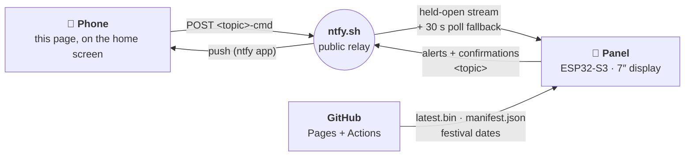
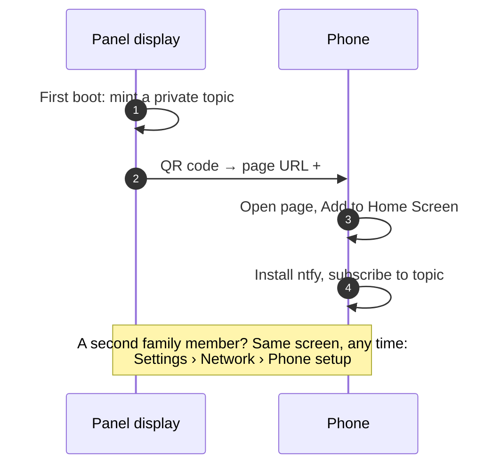
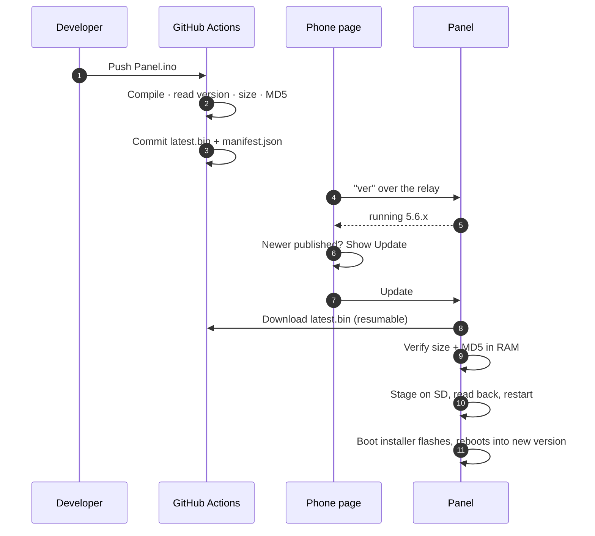

<div align="center">


# Panel

**A smart wall switchboard that belongs on the wall — and a phone app that needs no account.**

Motion-aware lighting · festival themes · on-device weather · doorbell alerts · one-tap remote control from anywhere

<br>

[](https://atharvguitarist.github.io/panel/firmware/manifest.json)
[](https://github.com/atharvguitarist/panel/actions/workflows/build.yml)


<br>

[**Overview**](#overview) · [**Architecture**](#architecture) · [**Phone app**](#the-phone-app) · [**Updates**](#over-the-air-updates) · [**Security**](#security-and-privacy) · [**Releasing**](#releasing-firmware)

</div>

---

## Overview

Panel replaces a conventional switchboard anywhere in a home — front door, living room, bedroom. A 7-inch touch display and an ESP32-S3 sit behind a single faceplate, switching the lights through solid-state relays, with the intelligence a wall switch never had.

<table>
<tr>
<td width="50%" valign="top">

### On the wall

- **Motion-aware lighting** with hold times, dimming and manual override
- **Two to eight outputs** from one firmware: tiles lay themselves out, names and rules follow each output
- **Festival themes** — Diwali, Holi, Navratri, Christmas and more — with countdowns and day-of greetings
- **Weather, clock and welcome screen** that wake with the room
- **Doorbell and motion alerts** pushed to every phone in the household
- **PIN-protected settings** with an on-device recovery path
- **Activity log** kept for a year on the SD card

</td>
<td width="50%" valign="top">

### In the pocket

- **One static web page** — no app store, no backend, no sign-up
- **Each light by name** — switch it, see its state, rename it — from anywhere
- **Status, restart and recent alerts** on demand
- **One-tap firmware updates** — the panel downloads, verifies and installs itself
- **Set up in two minutes** by scanning a QR code on the panel
- **Installs to the home screen** on iPhone and Android

</td>
</tr>
</table>

---

## Architecture

Three parties, one public relay, **zero application servers.**



**Identity is a topic name.** Each panel mints a unique topic on first boot and uses addresses derived from it:

| Address | Direction | Purpose |
|---|---|---|
| `<topic>` | Panel → phones | Doorbell and motion alerts; command confirmations |
| `<topic>-cmd` | Phones → panel | The command channel the buttons publish to |
| `<topic>-ver` | Panel → phones | Silent state line (`version|name=1,auto|name=0`) for the switches and the Update row |

The panel executes a strict whitelist of commands and acknowledges each on `<topic>`, so a household subscribes to **one** topic and sees alerts and confirmations in the same stream.

**The page is stateless and universal.** One copy serves every panel ever built. The per-device part — the topic — arrives in the URL fragment and never leaves the phone.

---

## The phone app

<table>
<tr>
<td width="55%" valign="top">

| Control | What it does |
|---|---|
| **One named switch per output** | Two, four or six, as the panel is configured, each showing its real name and current state; the motion light is tagged *Auto* or *Manual*. Switching the motion light on starts a manual session, off hands it back to the sensor |
| **Tap a name to rename** | The panel's tiles, its notifications and this page all use the new name |
| **All Off** | Every output off, motion automation back in charge |
| **Check Status** | The panel replies with its state: lights, link, uptime |
| **Recent Alerts** | Bottom sheet with the last 12 hours of notifications |
| **Restart Panel** | Confirm-twice, then a clean reboot |
| **Update** | Appears only when a newer firmware is published |

</td>
<td width="45%" valign="top">

**Designed to stay calm**

- The two lights are the hero; everything else is secondary
- Destructive actions need a second tap
- Honest feedback: *Sending…* → gold tick when the **panel itself** confirms
- Warm cream and burgundy, matching the on-device UI
- Dark mode, safe-area aware, installable

</td>
</tr>
</table>

### Pairing a panel



### Installed-app behaviour

The web app manifest is **generated at runtime**, once the topic is known — a static manifest's `start_url` cannot carry a per-device fragment, so the topic is stored on first open and restored on launch. iOS also preserves the fragment in the saved bookmark; both routes are handled.

---

## Over-the-air updates

The panel sits inside a wall with no USB access, so updating it is a first-class feature, not an afterthought.



| Safeguard | Why it exists |
|---|---|
| **Resumable download** | A wall panel on weak Wi-Fi drops a 1.3 MB stream now and then; each retry continues from the last byte |
| **Verified twice** | Size and MD5 in RAM, then a byte-for-byte read-back from the SD card |
| **Install at boot** | Flashing happens before Wi-Fi or the UI start, so nothing competes for the chip |
| **SD fallback** | Copy `latest.bin` to `/update/firmware.bin` and power-cycle — works with no network at all |
| **Local upload portal** | A five-minute, home-Wi-Fi-only page for dropping in a `.bin` by hand |
| **Crash recorder** | A panic is written to the activity log on the next boot, with an address that resolves to a function name |

---

## Security and privacy

> This section is written to be accurate rather than reassuring.

### Privacy by design

The host of this page learns **nothing** about any panel or household. That is a property of the architecture, not a promise:

- **The topic travels in the URL fragment** (`#t=…`). Browsers never send fragments to a server.
- **No cookies, no analytics, no third-party scripts, no web fonts.** The only outbound traffic is the command to the relay.
- **No server-side state.** No database, no user table, no session.
- **Persistence is local.** The topic is kept in the phone's `localStorage` so the installed app can launch; it syncs nowhere.

A reviewer can confirm all of this by reading `index.html`.

### Threat model

<details>
<summary><b>The topic name is the credential</b> — read the details</summary>

<br>

The relay is a public service: anyone who knows a topic name can subscribe or publish. Security therefore rests on topic names being unguessable.

**Generation.** The firmware mints topics from the ESP32's hardware RNG as `word-word-xxxx` — two words from curated 64-entry lists plus a four-character suffix from a 31-symbol alphabet with no look-alike characters. That is 64 × 64 × 31⁴ ≈ **3.8 × 10⁹** combinations. Users never choose topics, which removes the dictionary-word and reuse failures of user-chosen names.

**What a leaked topic allows.** Reading the panel's notifications, and sending the whitelisted commands: a light on or off, renaming a light, a status report, a restart, checking for and installing the **published** firmware, and opening a firmware-upload window that is reachable **only on the home network** for five minutes. No command unlocks anything, reads stored data or exposes credentials. Commands are ignored during a firmware write, and messages older than 90 seconds are never executed, so a queued command cannot replay after a reboot.

**What this page cannot do.** It cannot read notifications, cannot discover topics, and cannot reach a panel except through the relay. If the page's host disappeared, the buttons would stop — the panel, its automation and its notifications would not.

**Known limits.** Anyone who *observes* a topic — on the Phone Setup screen, or in a shared link — holds that panel's credential. The designed mitigation for volume deployment is the relay's reserved-topic access control (ntfy's paid tier or a self-hosted instance), where the panel authenticates with a token. That needs a small firmware change and none to this page.

**Transport.** All traffic is HTTPS.

</details>

---

## Releasing firmware

1. Edit `sketch/Panel/Panel.ino` and raise the number in `FW_VERSION_TAG`. **Every upload needs a new version**, even for a one-line change — the build refuses to publish different bytes under a version already published.
2. Commit. `build.yml` compiles the sketch, reads the version from the binary, writes `firmware/latest.bin`, `manifest.json` and `symbols.txt.gz`, commits them and redeploys Pages.
3. Panels see the new version on the phone page and update themselves.

**Festival dates** — put `config/festivals.txt` in the repository (`key,YYYY-MM-DD,YYYY-MM-DD`, one festival per line). `publish.yml` validates it and panels fetch it when its stamp changes. Navratri and other lunisolar dates come from the panchang, so the file is the single source of truth.

<details>
<summary><b>Repository layout</b></summary>

<br>

```
index.html               The entire phone application
sw.js                    Service worker: install criteria + offline shell
icon-*.png, apple-*.png  Home-screen icons
.nojekyll                Disables Jekyll processing on GitHub Pages

sketch/Panel/            Firmware source (Panel.ino, crash_note.*)
sketch/libraries/        Fonts library the firmware links
sketch/lv_conf.h         LVGL configuration
sketch/versions.env      Library versions the build uses

firmware/                latest.bin · manifest.json · symbols.txt.gz
                         (written by the build — never edit by hand)
tools/                   publish.py · validate_festivals.py
.github/workflows/       build.yml (compile + publish)
                         publish.yml (festival dates, or a prebuilt .bin)
```

</details>

<details>
<summary><b>Design system</b></summary>

<br>

The page shares a visual language with the panel's on-device UI, so the two read as one product.

| Role | Value | Notes |
|---|---|---|
| Background | `#F6E9CC` | Warm cream, matches the panel's settings screens |
| Card | `#FFFDF6` | Near-white, hairline border `#E3D8B8` |
| Primary action | `#7E102C` | Burgundy |
| Accent | `#C9A85C` | Gold, used sparingly |
| Text | `#3D3830` / `#5F4712` | Warm ink; gold-text for headings |

The firmware uses slightly *counter-tinted* variants of these colours to compensate for the display panel's colour shift. Phone screens render accurately, so this page uses the true values — the two surfaces match in perception rather than in hex. Typography is the system font stack; no web fonts are loaded, which removes a network dependency, a privacy leak and a render delay.

</details>

---

## Compatibility

| Platform | Browser | Standalone install | Notes |
|---|---|---|---|
| iOS 15+ | Safari | Share › Add to Home Screen | Fragment preserved in the bookmark |
| Android 8+ | Chrome | Install prompt | Maskable icon used |
| Any | Modern browser | Works as a normal page | Standalone not required |

Requires JavaScript. No polyfills; the page targets browsers from the last five years.

---

## Repository policy

This is a product component, not an open-source project.

- Contributions, pull requests and issues are **not accepted**. Issues, Discussions, Wikis and Projects are disabled, and interaction is limited to collaborators.
- `main` is protected against deletion, force-push and non-linear history.
- Workflows use only GitHub's own first-party actions; the firmware toolchain is downloaded from Arduino and Espressif at build time. The repository's Actions permission must be set to *Read and write*.
- The repository is public solely because GitHub Pages requires it.

## License

Copyright © 2026. **All rights reserved.**
